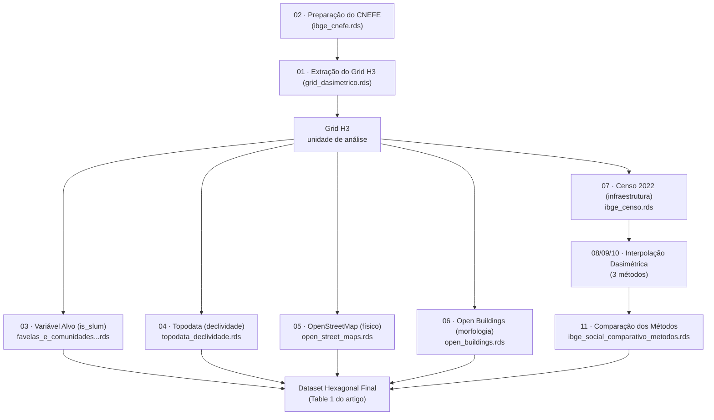

# Documentação de Bases de Dados e Reprodutibilidade: Pipeline de Identificação de Favelas

Este documento reúne, de forma didática, a explicação de **cada base de dados** utilizada no pipeline de identificação de favelas e comunidades urbanas, detalhando qual **script** a processa, os **arquivos de saída** gerados, e como cada uma se relaciona com a metodologia descrita no artigo de referência.

> Nascimento, G. A., Giannotti, M., Regueira, T. A., & Tomasiello, D. B. (2025). *Identifying slum areas: A multidimensional analysis leveraging with explanatory machine learning techniques*. Sustainable Cities and Society, 131, 106645.

O objetivo é garantir que qualquer pessoa consiga entender **o que cada base representa, o motivo de sua inclusão no modelo, e como reproduzir todo o processo do zero**, seguindo as boas práticas de arquitetura de projetos em R (isolamento de dependências com `renv` e caminhos relativos com `here`).

## Como ler este documento

A explicação de cada base de dados segue esta estrutura padronizada:  
1. **O que é a base** — Explicação clara, sem jargão técnico.  
2. **Por que está no modelo** — A dimensão da Tabela 1 do artigo à qual ela corresponde (Social, Físico, Ambiental, Características Urbanas).  
3. **De onde vem** — Fonte oficial dos dados.  
4. **Como é processada** — Resumo dos principais passos executados no script.  
5. **Script e saída** — Rastreabilidade entre o código-fonte e o arquivo final gerado (`.rds`).  
6. **Reprodutibilidade** — Parâmetros sensíveis (limiares, resoluções, CRS) e pontos de atenção que podem alterar os resultados.  

---

## Visão Geral do Pipeline

O pipeline segue exatamente a estrutura da **Fig. 1** do artigo:  
dados de entrada → pré-processamento (com fusão de dados) → dataset final em grid hexagonal → classificação. 

A **unidade de análise** é a mesma do artigo:  
grid **H3, resolução 10**, com área média de hexágono de **15.047,5 m²** (Seção 3.3 do artigo).

---

## 01 · Grid Hexagonal H3 (unidade de análise)

**O que é:** Uma malha de hexágonos que cobre a área urbana do município. Possui a vantagem de ter vizinhos à mesma distância em todas as direções.

**Por que está no modelo:** É a unidade de análise de todo o artigo (Fig. 1, caixa "Unit of Analysis"). Todas as outras bases de dados são agregadas para dentro dessa malha.

**De onde vem:** Gerados computacionalmente pela biblioteca H3 sobre o contorno dos setores censitários urbanos do IBGE (`{geobr}`, ano 2022).

**Como é processada:**
1. Baixa os setores censitários do município e filtra só a área **Urbana**.
2. Une esses setores num contorno único (com `st_make_valid()` para corrigir geometrias).
3. Preenche esse contorno com hexágonos H3 de resolução 10.
4. Aplica um **filtro dasimétrico**: mantém só os hexágonos que têm pelo menos um domicílio no CNEFE.

| | |
|---|---|
| **Script** | `01_extracao_dados.R` |
| **Saída** | `data/processed/grid_dasimetrico.rds` |
| **Depende de** | `ibge_cnefe.rds` (script 02) |

**Reprodutibilidade (Pontos de Atenção):**
- **Resolução (`resolucao_escolhida = 10`):** Mudar esse número altera a área de todos os hexágonos do projeto. 
- **Código Município (`sp_ = "3550308"`):** Fixo em São Paulo.

---

## 02 · CNEFE — Cadastro Nacional de Endereços

**O que é:** O "catálogo de endereços" do IBGE (Censo 2022) com latitude/longitude e classificação de uso (domicílio, escola, comércio, etc.).

**Por que está no modelo:** Usado para o **dasymetric mapping** (Fig. 1) — decide quais hexágonos são realmente habitados, evitando que o modelo tente classificar parques ou água.

**De onde vem:** IBGE, Censo Demográfico 2022.

**Como é processada:**
1. Lê o CSV bruto da UF.
2. Filtra apenas o município de estudo.
3. Recodifica categorias numéricas.
4. Mantém **apenas domicílios particulares**.
5. Converte latitude/longitude em pontos espaciais (`sf`), descartando coordenadas ausentes.

| | |
|---|---|
| **Script** | `02_preparacao_cnefe.R` |
| **Saída** | `data/processed/ibge_cnefe.rds` |
| **Usado por** | `01_extracao_dados.R` |

**Reprodutibilidade:**
- O bounding box do Brasil é uma checagem de sanidade global. Se houver poucos registros filtrados, verifique o código do município IBGE fornecido.

---

## 03 · Variável Alvo — `is_slum` (Favelas e Comunidades)

**O que é:** O rótulo (Target) que o modelo aprende a prever.

**Por que está no modelo:** Corresponde à linha "Slum and Communities" da Tabela 1 do artigo.

**De onde vem:** Base "Favelas e Comunidades Urbanas" do IBGE (Censo 2022).

**Como é processada:**
1. Calcula a interseção geométrica entre hexágonos e os polígonos de favela.
2. Calcula o percentual de cobertura.
3. Classifica como `"Slum"` os hexágonos com cobertura **≥ 70%** (limiar ótimo validado no Apêndice A do artigo).

| | |
|---|---|
| **Script** | `03_variavel_alvo_is_slum.R` |
| **Saídas** | `favelas_e_comunidades_urbanas_area_pura.rds` e alternativo ponderado por edificações |
| **Depende de** | `grid_dasimetrico.rds` (script 01) |

**Reprodutibilidade:**
- `limiar_classificacao <- 0.70`: Qualquer alteração muda o que é considerado "Slum" no projeto inteiro. Documente e refaça a análise de sensibilidade se alterar.

---

## 04 · Topodata — Declividade do Terreno

**O que é:** Raster (imagem em grade) com a declividade do terreno.

**Por que está no modelo:** Corresponde à linha "Average slope" da Tabela 1 (tipo Environmental). Terrenos em encosta são mais propensos a assentamentos informais.

**De onde vem:** INPE (Projeto TOPODATA).

**Como é processada:**
1. Mosaica os arquivos `.tif`.
2. Corrige o CRS.
3. Recorta o raster para o grid.
4. Calcula a **média de declividade** por hexágono.

| | |
|---|---|
| **Script** | `04_topodata_agregacao_h3.R` |
| **Saída** | `data/processed/topodata_declividade.rds` |
| **Depende de** | `grid_dasimetrico.rds` (script 01) |

---

## 05 · OpenStreetMap — Vulnerabilidade Física

**O que é:** Dados sobre ferrovias, rodovias, linhas de energia e corpos d'água.

**Por que está no modelo:** Corresponde às linhas de intersecção da Tabela 1 (tipo Physical characteristics). Proximidade a esses elementos indica vulnerabilidade física e de infraestrutura.

**De onde vem:** API do OpenStreetMap (`osmdata`).

**Como é processada:**
1. Consulta categorias via API.
2. Cria **buffer de 100 m** ao redor dos elementos.
3. Gera indicador binário se o hexágono toca os buffers.

| | |
|---|---|
| **Script** | `05_osm_vulnerabilidade_fisica.R` |
| **Saída** | `data/processed/open_street_maps.rds` |
| **Depende de** | `grid_dasimetrico.rds` (script 01) |

**Reprodutibilidade:**
- `distancia_buffer <- 100`: Valor do artigo. Os dados do OSM mudam com o tempo, recomenda-se salvar snapshot das extrações (RAW data).

---

## 06 · Open Buildings — Morfologia Urbana

**O que é:** Catálogo de edificações do mundo (polígonos baseados em imagem de satélite do Google).

**Por que está no modelo:** Corresponde às métricas de edificações da Tabela 1. Favelas possuem mais edificações, mas menores em média e mais variáveis (maior desvio-padrão).

**De onde vem:** Open Buildings Dataset (Google Research).

**Como é processada:**
1. Pré-filtro do CSV bruto por bounding box.
2. Recorte final para a área de estudo.
3. Agregação por hexágono (contagem, média de área, desvio-padrão).

| | |
|---|---|
| **Script** | `06_open_buildings_morfologia.R` |
| **Saída** | `data/processed/open_buildings.rds` |
| **Depende de** | `grid_dasimetrico.rds` (script 01) |

---

## 07 · Censo 2022 — Indicadores de Infraestrutura

**O que é:** Microdados de domicílios (água, esgoto, lixo) e entorno (calçadas, árvores).

**Por que está no modelo:** Corresponde às linhas Social / Urban characteristics. O uso de calçadas e árvores é uma contribuição de destaque do artigo (alta capacidade discriminativa).

**De onde vem:** IBGE (`censobr`).

**Como é processada:**
1. Soma por setor censitário métricas de acesso adequado (`_rede`) vs total (`_total`).
2. Associa as contagens à malha espacial dos setores censitários.

| | |
|---|---|
| **Script** | `07_censo_2022_infraestrutura.R` |
| **Saída** | `data/processed/ibge_censo.rds` |
| **Usado por** | Scripts 08, 09, 10 |

---

## 08–10 · Transferência do Setor Censitário para o Hexágono

Os dados do Censo (Script 07) estão em setores censitários, mas o modelo exige o grid H3. Foram criados três métodos para essa interpolação espacial:

1. **Opção 1 (Área Pura - Script 08):** Baseline do artigo. Assume densidade populacional uniforme no setor censitário.
2. **Opção 2 (Dasimetria por Edificações - Script 09):** Usa o Open Buildings como proxy populacional real.
3. **Opção 3 (Picnofilático de Tobler - Script 10):** Transforma setores numa superfície contínua e suave, preservando o volume original.

*Importante:* A soma dos valores interpolados deve sempre bater com a soma original. Os scripts contêm alarmes caso o erro ultrapasse 2%.

---

## 11 · Comparação dos Métodos Dasimétricos

**O que é:** Diagnóstico que compara a eficácia (empírica e teórica) das 3 opções de interpolação acima.
 
**Como funciona:** Realiza testes estatísticos e de correlação de Spearman para validar qual método gera maior contraste (sinal) entre áreas de Favela (`Slum`) e Não-Favela (`Non_Slum`).

| | |
|---|---|
| **Script** | `11_comparar_metodos_dasimetricos.R` |
| **Saída** | `data/processed/ibge_social_comparativo_metodos.rds` |
| **Depende de** | Scripts 08, 09, 10, 03 |

---

## Tabela-Resumo: Rastreabilidade de Fontes

| Base de Dados Original | Script Responsável | Arquivo de Saída (`.rds`) | Dimensão (Tabela 1) |
| :--- | :--- | :--- | :--- |
| Setores censitários (geobr) | `01_extracao_dados.R` | `grid_dasimetrico.rds` | Unidade de análise |
| CNEFE | `02_preparacao_cnefe.R` | `ibge_cnefe.rds` | Filtro dasimétrico (apoio) |
| Favelas e Comunidades | `03_variavel_alvo_is_slum.R` | `favelas_e_comunidades_urbanas_area_pura.rds` | Variável alvo (Y) |
| Topodata (INPE) | `04_topodata_agregacao_h3.R` | `topodata_declividade.rds` | Environmental |
| OpenStreetMap | `05_osm_vulnerabilidade_fisica.R` | `open_street_maps.rds` | Physical characteristics |
| Open Buildings (Google) | `06_open_buildings_morfologia.R` | `open_buildings.rds` | Physical |
| Censo 2022 (domicílios) | `07_censo_2022_infraestrutura.R` | `ibge_censo.rds` | Social / Urban characteristics |
| Interpolação dasimétrica | `08` / `09` / `10` / `11` | `ibge_social_*.rds` | Social / Urban characteristics |

---

## Checklist de Reprodutibilidade End-to-End e Arquitetura

Este repositório segue rigorosas boas práticas (conforme *Guia de Arquitetura R*):
- **Isolamento de dependências:** Ao clonar o repositório, rode `renv::restore()` para garantir que todos os pacotes correspondam à mesma versão testada no `renv.lock`.
- **Caminhos Relativos:** Não utilize `setwd()`. Os scripts usam o pacote `here::here()` para garantir portabilidade entre máquinas, salvando saídas sempre na pasta `data/processed/`.

**Para reconstruir o dataset consolidado a partir do zero, siga esta ordem estrita:**
1. `02_preparacao_cnefe.R` *(Sem dependências além dos dados brutos)*
2. `01_extracao_dados.R` *(Depende de 02)*
3. `07_censo_2022_infraestrutura.R` *(Lê dados brutos do Censo)*
4. `03`, `04`, `05`, `06` *(Todos podem rodar em paralelo, dependem apenas do script 01)*
5. `08`, `09`, `10` *(Dependem do Censo e Grid. Script 09 usa RAW Open Buildings)*
6. `11_comparar_metodos_dasimetricos.R` *(Depende de todas as saídas de 08-10 e rótulo de 03)*

**Parâmetros Globais Constantes (Críticos):**
- **Código Município:** `"3550308"` (São Paulo)
- **Resolução do H3:** `10`
- **CRS Métrico:** `EPSG:31983` (SIRGAS 2000 / UTM 23S)
- **Limiar de classificação is_slum:** `70%`
- **Buffer de vulnerabilidade física (OSM):** `100 m`
